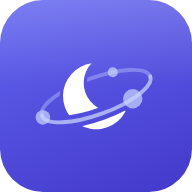

<p align="center">
  
</p>

<h1 align="center">MoonAgentic</h1>

<p align="center">Environnement de développement agentique : vos agents de code, une seule interface.</p>

MoonAgentic pilote les agents de code installés sur votre machine (Claude Code, Codex / GPT,
Antigravity `agy`, Cursor, Hermes via ACP, OpenCode et d'autres) depuis une interface web,
desktop et mobile. Projets, fils de discussion, worktree git par fil, revue des diffs, commit,
push et pull request en un clic.

## Origine et licence

MoonAgentic est un fork de [T3 Code](https://github.com/pingdotgg/t3code) (licence MIT,
© T3 Tools Inc.). La licence d'origine est conservée dans [LICENSE](./LICENSE) et le README
d'origine dans [README.t3code.md](./README.t3code.md). La branche `upstream-main` suit
`pingdotgg/t3code` pour récupérer les correctifs.

Ce que MoonAgentic ajoute : le design MoonAgentic (logo Orbite, palette et police Geist), puis
les fonctionnalités de la feuille de route (équipe multi-agents `/equipe`, planificateur, etc.).

## Lancer en développement

```bash
pnpm install        # Node 26 recommandé (voir package.json)
pnpm run dev        # serveur + web
pnpm run dev:desktop
```

Les données de MoonAgentic vivent dans `~/.moonagentic` (et non `~/.t3`), pour cohabiter avec
une installation de T3 Code.
