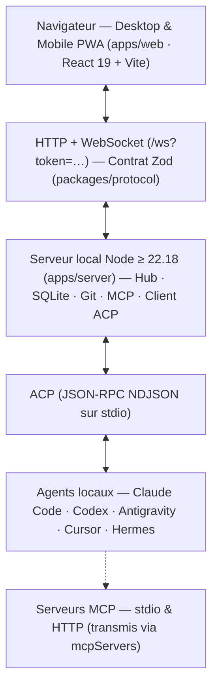

<p align="center">
  
</p>

<h1 align="center">MoonAgentic</h1>

<p align="center">
  <strong>Environnement de développement agentique (ADE) local, multi-agents et multi-écrans.</strong><br />
  Une seule interface web et mobile (PWA) pour piloter tes agents de code déjà installés sur ta machine, tes serveurs <strong>MCP</strong> et tes branches <strong>git</strong> isolées via le protocole ouvert <strong>ACP</strong>.
</p>

<p align="center">
  <a href="https://github.com/Moon-ItachiDEV/MoonAgentic/actions/workflows/ci.yml"></a>
  <a href="LICENSE"></a>
  = 22.18" />
  
  
</p>

<p align="center">
  <a href="#fonctionnalités">Fonctionnalités</a> ·
  <a href="#agents-pris-en-charge">Agents</a> ·
  <a href="#démarrage-rapide">Démarrage rapide</a> ·
  <a href="#configuration--sécurité">Sécurité</a> ·
  <a href="#architecture">Architecture</a> ·
  <a href="#développer">Développer</a>
</p>

---

## Pourquoi MoonAgentic ?

Les agents de code modernes (**Claude Code**, **Codex**, **Antigravity**, **Cursor**, **Hermes**…) vivent chacun dans leur propre terminal ou éditeur, avec leur propre configuration MCP et leur propre ergonomie. **MoonAgentic** repart de zéro pour les réunir dans un poste de pilotage unique, sobre et local — utilisable au bureau comme depuis un téléphone.

- **Un seul protocole, tous les agents** — MoonAgentic parle **ACP (Agent Client Protocol)** : un unique client JSON-RPC (NDJSON sur `stdio`) côté serveur pilote modèles, modes, raisonnement, outils, permissions, contexte et serveurs MCP de manière uniforme.
- **Tes outils, tes comptes, ta machine** — Le serveur lance les CLI et adaptateurs officiels localement. MoonAgentic ne voit, ne stocke et ne relaie jamais tes identifiants de connexion aux fournisseurs.
- **Travail isolé et réversible** — Chaque fil peut disposer de sa propre branche git (worktree dédié), de checkpoints silencieux avant chaque message (_« Revenir ici »_), d’une revue de diff intégrée et de l’envoi direct vers GitHub (commit, push, PR).
- **Léger et temps réel** — TypeScript natif sur Node ≥ 22.18, SQLite intégré (`node:sqlite`), WebSocket synchronisé entre appareils et interface React 19 installable en PWA.

---

## Fonctionnalités

### Multi-agents, modèles & passage de relais

- **Découverte dynamique des modèles** : chaque agent annonce ses propres modèles via ACP (`configOptions` et repli legacy `session/set_model`). Choix avant le premier message ou changement entre deux réponses.
- **Modèles favoris synchronisés** : épingle tes modèles habituels en haut du sélecteur ; les favoris sont enregistrés sur le serveur et partagés entre ordinateur et téléphone.
- **Changement d’agent en cours de fil** : passe la main d’un agent à un autre entre deux réponses. Les réponses précédentes restent signées par leur auteur, une ligne de relais apparaît dans la conversation et le nouvel agent reçoit automatiquement l’historique récent du fil (messages, titres d’outils et relais, jusqu’à 40 000 caractères).

### Pilotage fin du fil

- **Mode & raisonnement** : sélectionne le mode de travail (`Plan`, `Agent`…) et le niveau d’effort (`thought_level`, ou repli `session/set_mode`) proposés par l’agent, avant ou pendant un fil. Le mode actif s’affiche discrètement sur la puce de l’agent lorsqu’il diffère de son mode habituel.
- **Modes de permission par fil** :
  - **Supervisé** — validation explicite avant chaque modification ou commande.
  - **Accès complet** — approbation automatique des demandes d’autorisation.
- **Jauge de contexte & compactage** : un anneau à côté du bouton d’envoi suit l’occupation de la fenêtre de contexte (`usage_update`, seuils visuels à 70 % et 90 %) et propose **Compacter la conversation** (`/compact`) dès que l’agent l’annonce.

### Composer : `/` commandes, `@` fichiers, `$` skills, épingles et Ctrl K

- **`/` commandes** : tape `/` en début de message pour voir toutes les commandes, avec qui les propose. Celles de MoonAgentic agissent sur l’app (`/plan`, `/agent`, `/modeles`, `/epingler`, `/exporter`, `/chercher`, `/demandes`, `/connexions`), celles du projet viennent de `.moonagentic/commands/<nom>.md` (le texte du fichier, `$ARGUMENTS` prenant ce qui suit la commande), celles de l’agent sont celles qu’il annonce par ACP (`/compact`, `/init`…), et `/review`, `/test`, `/init` sont des messages tout prêts.
- **Règle de priorité visible** : quand deux commandes portent le même nom, l’ordre est MoonAgentic (actions), puis le projet, puis l’agent, puis les messages tout prêts. La ligne gagnante indique « remplace celle de … ».
- **`@` fichiers** : cherche dans les fichiers du dossier du fil (worktree compris, fichiers ignorés exclus) et les joint au message. L’agent reçoit le contenu des petits fichiers texte s’il accepte le contexte intégré (`embeddedContext`), un lien `file://` sinon. Aucun chemin ne peut sortir du dossier, liens symboliques compris.
- **`$` skills** : appelle un skill (`SKILL.md`) trouvé dans `.claude/skills`, `.agents/skills` ou `.codex/skills`, du projet ou de ton dossier personnel. Son fichier est joint au message, donc ça marche avec tous les agents.
- **Fils épinglés** : épingle un fil depuis la barre latérale, `/epingler` ou Ctrl K ; il reste en haut, sur tous tes appareils.
- **Recherche rapide (Ctrl K / ⌘ K)** : fils, projets, actions et texte des messages de tous les fils. Choisir un message ouvre son fil et le montre.

### Connexions et demandes en attente

- **Écran Connexions** : chaque agent avec son état (prêt, pas installé, connexion requise, erreur au démarrage), la commande qui le lance, la version qu’il annonce et quand il a été vérifié. **Vérifier** le démarre un instant pour s’en assurer. Les agents passent toujours par leur propre outil et ta propre connexion : MoonAgentic ne voit ni ne garde aucun mot de passe ni jeton.
- **Tes propres agents** : ajoute n’importe quel agent qui parle ACP en donnant son nom et la commande qui le lance (`mon-agent acp`), retire-le quand tu veux. Un fil dont l’agent n’est plus là peut passer à un autre agent depuis le composer.
- **À traiter** : toutes les demandes d’accord des agents, tous fils confondus, avec leur nombre dans la barre latérale. Tu réponds sans ouvrir le fil, ou tu l’ouvres d’un clic (`/demandes`, Ctrl K).
- **Coût par fil** : quand l’agent le donne (`usage_update.cost`), la jauge de contexte affiche ce que le fil a coûté.

### Espace git par fil (worktrees, revue, PR & checkpoints)

- **Branche à part par défaut** : dans un projet git, chaque fil reçoit son propre worktree (`~/.moonagentic/worktrees/<id>`, branche `moon/<titre>-<id>`) sans jamais toucher ni salir le dossier principal du projet.
- **Panneau « À revoir »** : affiche tout ce que la branche modifie depuis son point de départ (commité ou non, fichiers créés, renommés, supprimés ou binaires) à partir d’un index git jetable (`GIT_INDEX_FILE`) qui laisse la zone de staging intacte.
- **Choix des fichiers à envoyer** : chaque fichier a sa case dans « À revoir ». Les fichiers qui ressemblent à des secrets (`.env`, clés, `.npmrc`…) partent décochés. Seuls les fichiers cochés sont commités, rien d’autre de ce que l’agent aurait mis en staging. La revue ne stocke rien dans git et s’arrête à 1 000 fichiers.
- **Commit, push & pull request** : commite avec ton message, pousse la branche et ouvre la PR via ton propre `gh` CLI (s’il est installé et connecté), avec repli automatique vers la page GitHub _compare_.
- **Checkpoints « Revenir ici »** : avant chaque tour sur une branche isolée, MoonAgentic capture l’état des fichiers dans un arbre git (`refs/moonagentic/<fil>/<message>`), sans polluer l’historique de commits. Revenir à un message restaure les fichiers (en rétablissant d’abord les règles `.gitignore` pour préserver `.env`, `node_modules`…), efface la suite du fil, rétablit l’agent de l’époque si un relais avait eu lieu, et replace le texte du message dans le composer.
- **Archiver, supprimer** : archiver un fil range sa copie de travail après avoir gardé ses fichiers (non commités compris) dans git ; le désarchiver les remet. Supprimer un fil efface ses messages et sa copie de travail, mais sa branche et ses commits restent dans le dépôt. Retirer un projet ne touche jamais à son dossier.
- **Projet dans un sous-dossier** : un projet ouvert sur `apps/web` d’un dépôt fait travailler l’agent dans `apps/web` de sa copie de travail.
- **Reprise après un arrêt** : une copie de travail à moitié créée, disparue ou jamais enregistrée est refaite depuis sa branche, et un retour en arrière interrompu est terminé au redémarrage.

### Serveurs MCP centralisés

- **Enregistrés une fois, transmis à tous les agents** : ajoute des serveurs MCP par commande (`stdio`, ex. `npx -y …`) ou par adresse (`http`, ex. `https://…`) depuis l’écran **Serveurs MCP**, active-les ou désactive-les à la volée.
- **Respect des capacités ACP** : les serveurs `stdio` sont transmis à tous les agents ; les serveurs HTTP ne sont transmis qu’aux agents annonçant `mcpCapabilities.http`.
- **Secrets strictement locaux** : les variables d’environnement et en-têtes secrets restent sur la machine du serveur ; l’interface ne reçoit jamais leur valeur.

### Expérience Desktop + Mobile (PWA)

- Streaming temps réel en Markdown (assaini via DOMPurify), réflexions repliables, plans d’exécution, appels d’outils avec diffs de fichiers et annulation d’un tour en cours.
- Interface responsive avec tiroir latéral, sélecteur en feuille basse (_bottom sheet_) sur téléphone, thème clair/sombre automatique et manifeste PWA (`standalone`).

---

## Agents pris en charge

| Agent              | Intégration                       | Binaire / paquet                        | Connexion initiale (hors MoonAgentic) |
| ------------------ | --------------------------------- | --------------------------------------- | ------------------------------------- |
| **Claude Code**    | Inclus (adaptateur ACP officiel)  | `@agentclientprotocol/claude-agent-acp` | `claude` puis `/login` (ou clé API)   |
| **Codex**          | Inclus (adaptateur ACP officiel)  | `@agentclientprotocol/codex-acp`        | `codex login` (ou clé API)            |
| **Antigravity**    | ACP natif (détecté sur le `PATH`) | `agy acp` (démarre sur _Neon_)          | `agy`                                 |
| **Cursor**         | ACP natif (détecté sur le `PATH`) | `cursor-agent acp` ou `agent acp`       | `agent login`                         |
| **Hermes**         | ACP natif (détecté sur le `PATH`) | `hermes acp`                            | `hermes model`                        |
| **Agents de démo** | Option `--demo` (2 agents)        | `demo-agent.ts`                         | Aucune (gratuit, hors-ligne)          |

> **Conformité & authentification** : chaque personne se connecte une fois avec son propre compte dans l’outil officiel de l’agent (ou configure sa propre clé API dans son environnement). MoonAgentic exécute ces outils tels quels sur ta machine et ne voit, ne stocke ni ne relaie aucun identifiant (conforme aux règles des fournisseurs, dont [Anthropic](https://code.claude.com/docs/en/legal-and-compliance)).

---

## Démarrage rapide

### Prérequis

- **Node.js ≥ 22.18** (exécution TypeScript native et `node:sqlite`)
- **pnpm 10+**
- **git** (recommandé pour les branches isolées, la revue et les checkpoints)
- **GitHub CLI (`gh`)** (optionnel, pour ouvrir les pull requests en un clic)

### Installer et lancer

```sh
pnpm install
pnpm build   # construit l'interface web dans apps/web/dist
pnpm start   # démarre le serveur et affiche le lien avec ton jeton
```

Ouvre le lien affiché dans le terminal (de la forme `http://127.0.0.1:4747/?token=…`).

### Essayer gratuitement sans clé ni compte

```sh
node apps/server/src/bin.ts --demo
```

L’option `--demo` ajoute **deux agents locaux simulés** pour tester tout le parcours hors-ligne : streaming, réflexions, plans, diffs, permissions, choix du modèle, mode Plan, raisonnement, jauge de contexte, `/compact`, MCP, worktrees, checkpoints et changement d’agent.

### Ouvrir depuis un téléphone (réseau local / VPN)

```sh
node apps/server/src/bin.ts --host 0.0.0.0
```

Ouvre le lien affiché en remplaçant `localhost` par l’adresse IP locale de ta machine (ou son adresse Tailscale / WireGuard), puis ajoute la page à l’écran d’accueil pour l’utiliser en mode application.

> **Sécurité réseau** : le serveur n’écoute que sur `127.0.0.1` par défaut. N’utilise `--host 0.0.0.0` que sur un réseau local de confiance ou derrière un tunnel chiffré (Tailscale, WireGuard, SSH). Le lien contient ton jeton, qui donne la main sur tes agents et tes fichiers : en HTTP simple, quiconque écoute le réseau peut le lire. Le serveur te le rappelle au démarrage dès qu’il écoute au-delà de ta machine.

---

## Configuration & sécurité

### Options CLI et variables d’environnement

Le serveur (`apps/server/src/bin.ts`) accepte les options suivantes :

| Option       | Variable d’environnement | Défaut           | Description                                                        |
| ------------ | ------------------------ | ---------------- | ------------------------------------------------------------------ |
| `--port`     | `MOONAGENTIC_PORT`       | `4747`           | Port HTTP et WebSocket (`/ws`) du serveur                          |
| `--host`     | —                        | `127.0.0.1`      | Interface d’écoute (`0.0.0.0` pour accéder depuis un téléphone)    |
| `--data-dir` | `MOONAGENTIC_HOME`       | `~/.moonagentic` | Dossier des données locales (`state.sqlite`, `token`, `worktrees`) |
| `--demo`     | —                        | `false`          | Ajoute les deux agents de démo                                     |
| `--dev`      | —                        | `false`          | Mode développement (active `--demo`, UI servie par Vite sur 5173)  |

### Stockage local et garanties de sécurité

- **Dossier privé** : sur Linux/macOS, `~/.moonagentic` est verrouillé en `0700`, et `token`, `state.sqlite`, `state.sqlite-wal` et `state.sqlite-shm` en `0600`.
- **Authentification par jeton** : généré aléatoirement au premier démarrage (`~/.moonagentic/token`) et vérifié en temps constant (`timingSafeEqual`) sur `/api/auth` et `/ws`.
- **Page protégée** : l’interface refuse d’être affichée dans le cadre d’un autre site et ne charge rien d’ailleurs (`Content-Security-Policy`), pour qu’une réponse d’agent ne puisse ni piéger un clic ni faire sortir des données par une adresse d’image.
- **Secrets MCP non exposés** : seules les clés (`secretNames`) transitent vers l’interface ; les erreurs de saisie désignent la ligne fautive par son numéro sans jamais recopier son contenu.
- **Contrat validé de bout en bout** : tous les messages WebSocket sont validés par Zod 4 (`packages/protocol`), les noms de variables d’environnement et d’en-têtes HTTP (RFC 9110) sont vérifiés, et le rendu Markdown est filtré par DOMPurify.

---

## Architecture



### Structure du monorepo

| Chemin                       | Rôle                                                                                                      |
| ---------------------------- | --------------------------------------------------------------------------------------------------------- |
| `packages/protocol`          | Types partagés et schémas Zod (`ClientMessage`, `ServerMessage`, `Snapshot`, `Thread`, `Item`…).          |
| `apps/server/src/bin.ts`     | Point d’entrée CLI, préparation du dossier de données privé, arrêt propre des agents.                     |
| `apps/server/src/http.ts`    | Serveur HTTP (fichiers statiques, `/api/auth`), WebSocket `/ws`, décodage Zod et corrélation de requêtes. |
| `apps/server/src/hub.ts`     | Orchestration des projets, fils, tours, verrous exclusifs, permissions, favoris, MCP, git et relais.      |
| `apps/server/src/session.ts` | Client ACP unique (`initialize`, `authenticate`, `session/*`, `configOptions`, `modes`, `usage_update`).  |
| `apps/server/src/agents.ts`  | Résolution des adaptateurs npm inclus et des CLI ACP natives sur le `PATH`.                               |
| `apps/server/src/git.ts`     | Worktrees, revue de diff sur index jetable, checkpoints `refs/moonagentic/*`, commit, push et PR (`gh`).  |
| `apps/server/src/history.ts` | Construction de l’historique récent transmis lors d’un changement d’agent ou d’une nouvelle session.      |
| `apps/server/src/mcp.ts`     | Projection sans secret (`mcpInfo`) et conversion vers le format ACP (`acpMcpServers`).                    |
| `apps/server/src/store.ts`   | Persistance SQLite (`node:sqlite`, mode WAL) et migrations additives automatiques.                        |
| `apps/web`                   | Interface React 19 / Vite (sidebar, composer, sélecteur, panneau de revue, dialogue MCP, jauge).          |

---

## Feuille de route

MoonAgentic est construit par jalons successifs :

- [x] **Jalon 1 — Socle ADE** : sidebar, composer, streaming temps réel ACP (messages, réflexions, plans, outils, diffs), permissions supervisées / accès complet, historique SQLite.
- [x] **Jalon 2 — Multi-agents & modèles** : Codex et Cursor, découverte dynamique des modèles, changement entre deux réponses et favoris synchronisés.
- [x] **Jalon 3 — MCP & espace git par fil** : serveurs MCP centralisés (secrets locaux), worktrees par fil, panneau _« À revoir »_, commit, push, PR (`gh` / GitHub _compare_), CI Windows.
- [x] **Jalon 4 — Pilotage du fil** : mode et raisonnement de l’agent, jauge de contexte et `/compact`, checkpoints _« Revenir ici »_, changement d’agent en cours de fil avec relais d’historique.
- [x] **Jalon 5 — Commandes et composer** : commandes `/` (MoonAgentic, projet, agent), mentions `@` de fichiers, skills `$`, fils épinglés, recherche Ctrl K, export Markdown, choix des fichiers à l’envoi, premier test de bout en bout dans un vrai navigateur.
- [x] **Jalon 6a — Connexions** : état de chaque agent (version, connexion requise), agents ACP ajoutés par l’utilisateur, pile « À traiter » de toutes les demandes d’accord, coût par fil, relais depuis un agent devenu indisponible.
- [x] **Jalon 6b — Archives et base** : archivage et suppression des fils et des projets avec nettoyage des worktrees, schéma SQLite versionné avec migrations et sauvegarde automatique avant chaque migration, projets dans un sous-dossier d’un dépôt, reprise après un arrêt en plein travail.
- [ ] **Suite** : synchronisation/rebase des branches, et emballage en **application desktop Windows (Electron)** une fois le cœur stabilisé.

---

## Développer

```sh
pnpm dev        # serveur (--dev, avec 2 agents de démo) + Vite avec HMR (http://127.0.0.1:5173)
pnpm test       # suite de tests Vitest (serveur, git, MCP, protocole, parsing web)
pnpm lint       # Oxlint + vérification Prettier
pnpm typecheck  # vérification TypeScript sur tout le monorepo
pnpm format     # formatage automatique Prettier
pnpm build      # build de production de l'interface web
pnpm e2e        # parcours de bout en bout dans Chromium (après pnpm build ; Playwright)
```

Avant le premier `pnpm e2e`, installe Chromium pour Playwright : `pnpm exec playwright install chromium`.

En développement, Vite n’écoute lui aussi que sur ta machine. Pour l’ouvrir depuis un autre appareil, sur un réseau de confiance : `MOONAGENTIC_DEV_HOST=0.0.0.0 pnpm dev`.

### Stack technique

- **Backend** : Node.js ≥ 22.18, TypeScript natif, `node:sqlite`, `ws`, `@agentclientprotocol/sdk`
- **Frontend** : React 19, Vite 8, `marked`, `dompurify`
- **Contrat & qualité** : Zod 4, Vitest, Oxlint, Prettier, CI GitHub Actions (Linux + Windows)

---

## Licence

Distribué sous licence **MIT** — voir [LICENSE](LICENSE).
